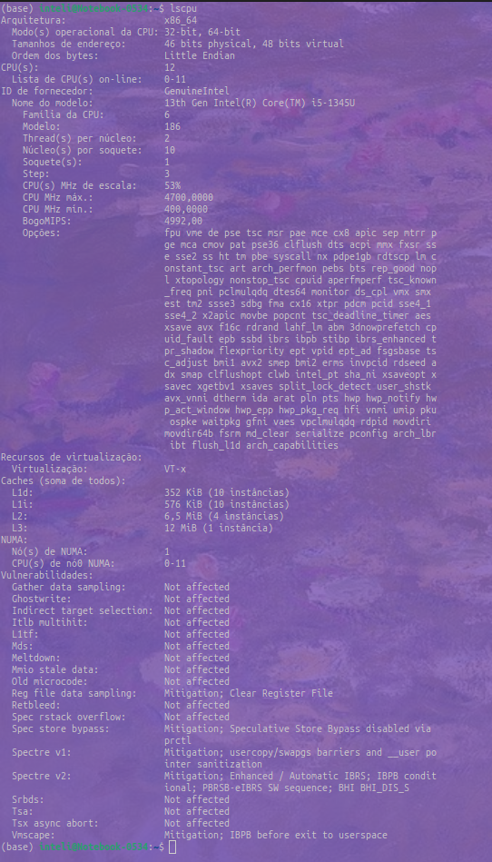
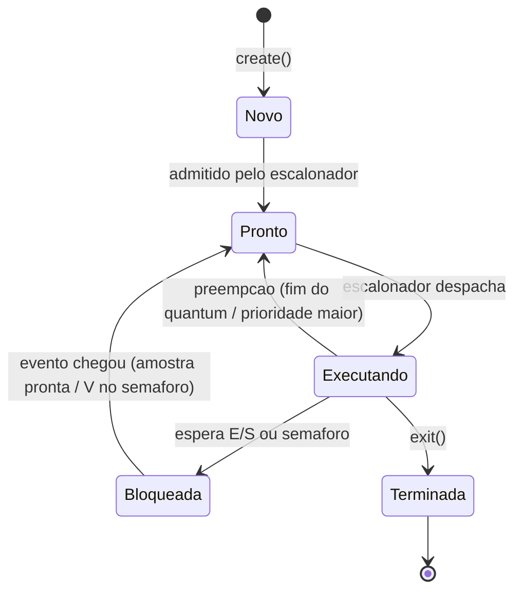
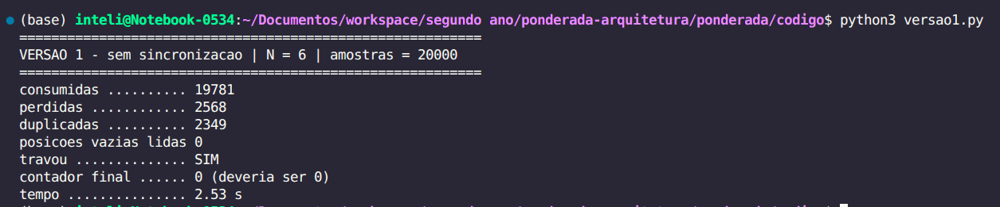
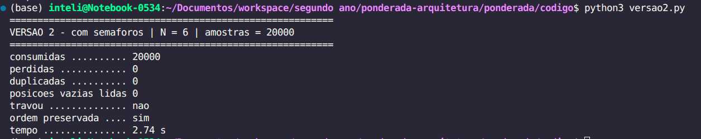
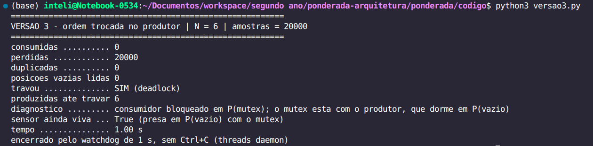
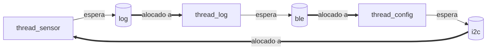

# Ponderada do pipeline ao deadlock

**Nome**: Lívia Sabóia Tavares 

**D1** = 5 

**D2** = 8

**N** = 6


| Parâmetro | Valor | Usado em |
| :---- | :---- | :---- |
| Instruções por amostra (IC) | 260.000 | A1 |
| Taxa de falta na cache L1 do SoC (m) | 5,5% | A1 |
| Tamanho do buffer (N) | 6 | A4 |

**Requisito adicional**: cada amostra tem que ser processada em no máximo 5 ms, com uma amostra a cada 10 ms.

# Parte A: o problema técnico

## A1. Arquitetura e memória: qual processador vai na pulseira?

### A1.1 Tempo por amostra na Plataforma H

O tempo de CPU pode ser medido por:
$T_{CPU} = CPI \times IC \times T_{ciclo}$

O meu número de instruções por amostra (IC) é de 260000, o CPI é de 1,5 e o tempo de ciclo é 1/frequência do ciclo, em que a frequência do ciclo é 48MHz. Fazendo as contas, temos

$T_{CPU} = 1.5 \times 260000 \times 1/(48 \times 10^{6})$

Ou seja, o $T_{CPU}$ é 8,125ms. Não atende ao critério de processamento em até 5ms.

### A1.2 AMAT, CPI efetivo e tempo por amostra na Plataforma V

O AMAT (para nível único) pode ser calculado por:

$AMAT = T_{acerto} + taxa_{falhas} \times penalidade_{falha}$

Ou seja, substituindo temos:

$AMAT = 1 + 0,055 \times 120$
$AMAT$ = 7.6

Para o CPI efetivo:

$CPI_{efetivo} = 1 + (acessos \times m \times penalidade)$

Ou seja,

$CPI_{efetivo} = 1 + (1,3 \times 0,055 \times 120)$

$CPI_{efetivo}$ = 9.58

Então, o tempo por amostra vai ser, no caso médio:

$T_{amostra} = (IC \times CPI_{efetivo})/f$
$T_{amostra} = (260000 \times 9.58)/1,2 * 10^{9}$
$T_{amostra}$ = 2,08 ms

No pior caso, somando os 3ms de atraso do sistema operacional:

$T_{amostra}$ = 5,08ms

A plataforma V atende ao requisito no caso típico e falha no pior caso, e como o requisito é de tempo real, quem manda é o pior caso, logo ela reprova.

### A1.3 Acelerador DSP na Plataforma H (Lei de Amdahl)

A lei de amdahl é dada por:

$Ganho = 1/((1-f) + f/s)$

Com f sendo a fração do tempo de execução e s a taxa de aceleração.

Assim, o ganho é de $1/((1-0,6) + 0,6/5)$, ou seja, $ganho$ = 1,92.

Com base nisso, o novo tempo por amostra será 4,23ms (tempo máximo anterior/ganho), o que atende ao requisito de < 5ms.

### A1.4 Por que a V precisa de cache e a H não

Na V, instruções e dados moram na mesma memória e passam pelo mesmo barramento, então a busca de instrução e acesso a dados competem pelo mesmo caminho. O processador fica esperando a memória, e quem limita o desempenho é o barramento. O núcleo roda a 1,2 GHz e a DRAM externa cobra 120 ciclos por falta, com 1,3 acessos por instrução. Sem cache, o custo de memória dominaria o tempo por amostra. A cache explora localidade temporal e espacial para atender a maior parte dos acessos em 1 ciclo, derrubando o custo médio para o AMAT de 7,6 ciclos.

A H é Harvard: memórias e barramentos separados para instrução e dado, então as duas buscas acontecem em paralelo e o conflito não existe. Além disso, a SRAM interna responde em 1 ciclo na velocidade do núcleo de 48 MHz. Cache só faz sentido quando existe uma diferença grande entre a velocidade do processador e a da memória. Como na H essa diferença não existe, então a cache não teria o que melhorar.

### A1.5 Evidência da sua máquina



Como uso ubuntu, usei `lscpu` para ver os caches. A minha L1 é sim dividida em instrução e dados, como dá pra ver pela separação de uma linha de L1i e L1d. 

Meu computador é Harvard modificado (Von Neumann com a L1 dividida). Existe essa separação entre instrução e dados na L1, mas a L2 e a L3 são unificadas.

## A2. Pipeline: o loop do filtro

Trecho analisado:

```asm
1  lw   x5, 0(x10)     # lê a amostra nova
2  add  x6, x6, x5     # soma += nova
3  lw   x7, 0(x11)     # lê a amostra mais antiga
4  sub  x6, x6, x7     # soma -= antiga
5  sw   x6, 0(x12)     # grava a soma
6  addi x10, x10, 4    # avança o ponteiro da nova
7  addi x11, x11, 4    # avança o ponteiro da antiga
```

Considerando: pipeline de 5 estágios (IF, ID, EX, MEM, WB), banco de registradores escrito na primeira metade do ciclo e lido na segunda.

### A2.1 Dependências de dados (RAW)

RAW = o x5, na segunda instrução, é lido depois de ser escrito na primeira. Do mesmo jeito, x7 é lido na quarta após ser escrito na terceira. Além dessas duas, a soma acumulada em x6 gera outras duas: a quarta depende do x6 que a segunda escreveu, e a quinta depende do x6 que a quarta escreveu.

| Produtora | Consumidora | Registrador |
| :---- | :---- | :---- |
| 1 `lw x5, 0(x10)` | 2 `add x6, x6, x5` | x5 |
| 2 `add x6, x6, x5` | 4 `sub x6, x6, x7` | x6 |
| 3 `lw x7, 0(x11)` | 4 `sub x6, x6, x7` | x7 |
| 4 `sub x6, x6, x7` | 5 `sw x6, 0(x12)` | x6 |

As duas primeiras, 1 -> 2 e 3 -> 4, são dependências de load-use, porque quem produz o dado é uma `lw`. As outras duas são de ALU para ALU.

Existem também duas dependências WAR, que não geram bolha em um pipeline que executa em ordem: x10 é lido pela 1 e reescrito pela 6, e x11 é lido pela 3 e reescrito pela 7. A leitura em ID de uma instrução anterior sempre acontece antes da escrita em WB de uma posterior, então nenhuma das duas para o pipeline.

### A2.2 Pipeline sem forwarding

Sem forwarding o dado só aparece no banco de registradores. Como a escrita acontece na primeira metade do ciclo e a leitura na segunda, a consumidora consegue fazer o ID no mesmo ciclo do WB da produtora. Com isso, duas instruções dependentes e seguidas custam 2 bolhas.

Legenda: b = bolha, ou seja, instrução parada esperando o dado.

| Instrução | 1 | 2 | 3 | 4 | 5 | 6 | 7 | 8 | 9 | 10 | 11 | 12 | 13 | 14 | 15 | 16 | 17 |
| :---- | :-: | :-: | :-: | :-: | :-: | :-: | :-: | :-: | :-: | :-: | :-: | :-: | :-: | :-: | :-: | :-: | :-: |
| 1 lw x5 | IF | ID | EX | MEM | WB |  |  |  |  |  |  |  |  |  |  |  |  |
| 2 add x6 |  | IF | b | b | ID | EX | MEM | WB |  |  |  |  |  |  |  |  |  |
| 3 lw x7 |  |  | IF | b | b | ID | EX | MEM | WB |  |  |  |  |  |  |  |  |
| 4 sub x6 |  |  |  |  |  | IF | b | b | ID | EX | MEM | WB |  |  |  |  |  |
| 5 sw x6 |  |  |  |  |  |  |  |  | IF | b | b | ID | EX | MEM | WB |  |  |
| 6 addi x10 |  |  |  |  |  |  |  |  |  |  |  | IF | ID | EX | MEM | WB |  |
| 7 addi x11 |  |  |  |  |  |  |  |  |  |  |  |  | IF | ID | EX | MEM | WB |

Bolhas por dependência:

- 1 -> 2 (x5): 2 bolhas, porque a `add` só consegue ler x5 no ciclo 5, que é o WB da `lw`.
- 3 -> 4 (x7): 2 bolhas, mesma situação agora com x7.
- 4 -> 5 (x6): 2 bolhas, porque a `sw` só consegue ler x6 no ciclo 12, que é o WB da `sub`.
- 2 -> 4 (x6): nenhuma bolha. A `add` termina o WB no ciclo 8 e a `sub` só chega no ID no ciclo 9, então as bolhas que já existiam por causa do x7 cobriram essa dependência.

Total de ciclos (primeiro IF ao último WB): 17 ciclos. Sem nenhuma parada o trecho levaria 7 + 4 = 11 ciclos, e as 6 bolhas (2 + 2 + 2) levam o total a 17.

### A2.3 Pipeline com forwarding

Com forwarding as dependências de ALU para ALU somem, porque o resultado sai do registrador de pipeline EX/MEM direto para a entrada da ALU. As duas de load-use continuam custando 1 bolha cada, já que o dado da memória só existe no fim do MEM.

| Instrução | 1 | 2 | 3 | 4 | 5 | 6 | 7 | 8 | 9 | 10 | 11 | 12 | 13 |
| :---- | :-: | :-: | :-: | :-: | :-: | :-: | :-: | :-: | :-: | :-: | :-: | :-: | :-: |
| 1 lw x5 | IF | ID | EX | MEM | WB |  |  |  |  |  |  |  |  |
| 2 add x6 |  | IF | ID | b | EX | MEM | WB |  |  |  |  |  |  |
| 3 lw x7 |  |  | IF | b | ID | EX | MEM | WB |  |  |  |  |  |
| 4 sub x6 |  |  |  |  | IF | ID | b | EX | MEM | WB |  |  |  |
| 5 sw x6 |  |  |  |  |  | IF | b | ID | EX | MEM | WB |  |  |
| 6 addi x10 |  |  |  |  |  |  |  | IF | ID | EX | MEM | WB |  |
| 7 addi x11 |  |  |  |  |  |  |  |  | IF | ID | EX | MEM | WB |

Caminhos de forwarding usados:

- 1 -> 2 (x5): MEM/WB para EX, com 1 bolha antes.
- 2 -> 4 (x6): EX/MEM para EX, sem bolha.
- 3 -> 4 (x7): MEM/WB para EX, com 1 bolha antes.
- 4 -> 5 (x6): EX/MEM para EX, sem bolha.

Total de ciclos: 13 ciclos, que são os 11 ideais mais as 2 bolhas.

Dependência que continua causando bolha, e por quê: as duas de load-use, `lw x5` para `add` e `lw x7` para `sub`. O valor lido da memória só fica pronto no fim do estágio MEM da `lw`, e a instrução seguinte precisaria dele no começo do seu EX, que cai no mesmo ciclo. O forwarding leva o dado de um ponto a outro do pipeline, mas não consegue entregar no começo de um ciclo um valor que só nasce no fim dele. Por isso o hardware é obrigado a atrasar a consumidora em 1 ciclo.

### A2.4 Reordenação sem bolhas

A ideia é afastar cada `lw` da instrução que usa o resultado dela, colocando no meio um trabalho útil que não dependa desse valor. Os dois `addi` dos ponteiros servem bem para isso.

Nova ordem:

```asm
1  lw   x5, 0(x10)     # lê a amostra nova
2  lw   x7, 0(x11)     # lê a amostra mais antiga
3  addi x10, x10, 4    # avança o ponteiro da nova (preenche a bolha do lw x5)
4  add  x6, x6, x5     # soma += nova
5  sub  x6, x6, x7     # soma -= antiga
6  addi x11, x11, 4    # avança o ponteiro da antiga
7  sw   x6, 0(x12)     # grava a soma
```

Por que o resultado não muda:

- Os dois `lw` continuam acontecendo antes dos `addi` que mexem em x10 e x11, então cada um lê o mesmo endereço que lia na ordem original. Antecipar o `addi x10` é seguro porque a `lw x5` já consumiu o x10 antigo no ciclo anterior.
- A ordem das operações sobre x6 foi mantida: primeiro a `add` (soma += nova), depois a `sub` (soma -= antiga) e só então o `sw`.
- O `sw` continua sendo a última operação sobre x6 e grava o mesmo valor final.
- São as mesmas 7 instruções, nenhuma foi criada nem removida.

Verificação ciclo a ciclo:

| Instrução | 1 | 2 | 3 | 4 | 5 | 6 | 7 | 8 | 9 | 10 | 11 |
| :---- | :-: | :-: | :-: | :-: | :-: | :-: | :-: | :-: | :-: | :-: | :-: |
| 1 lw x5 | IF | ID | EX | MEM | WB |  |  |  |  |  |  |
| 2 lw x7 |  | IF | ID | EX | MEM | WB |  |  |  |  |  |
| 3 addi x10 |  |  | IF | ID | EX | MEM | WB |  |  |  |  |
| 4 add x6 |  |  |  | IF | ID | EX | MEM | WB |  |  |  |
| 5 sub x6 |  |  |  |  | IF | ID | EX | MEM | WB |  |  |
| 6 addi x11 |  |  |  |  |  | IF | ID | EX | MEM | WB |  |
| 7 sw x6 |  |  |  |  |  |  | IF | ID | EX | MEM | WB |

- `lw x5` (WB no ciclo 5) para `add` (ID no ciclo 5): o x5 é lido direto do banco, porque a escrita é na primeira metade e a leitura na segunda. Zero bolha e nem precisa de forwarding.
- `lw x7` (MEM no ciclo 5) para `sub` (EX no ciclo 7): sobra uma folga inteira, resolvido por MEM/WB para EX.
- `add` (EX no ciclo 6) para `sub` (EX no ciclo 7): EX/MEM para EX, zero bolha.
- `sub` (MEM no ciclo 8) para `sw` (EX no ciclo 9): MEM/WB para EX, zero bolha.

Novo total de ciclos: 11 ciclos, que é o mínimo possível para 7 instruções em um pipeline de 5 estágios (7 + 4). Saímos de 17 sem forwarding para 13 com forwarding e 11 com forwarding mais reordenação, ou seja 35% mais rápido que o pipeline sem forwarding só mudando a ordem das instruções.

## A3. Processos e threads: como organizar o software

### A3.1 Organização proposta

Separei as tarefas pela fronteira de confiança e de tempo real. As três que estão no caminho crítico dos 5 ms viram threads de um único processo de tempo real, e o BLE, que é o único que recebe dado de fora e também o único sem prazo duro, vira processo separado.

| Tarefa | Thread ou processo | Justificativa |
| :---- | :---- | :---- |
| Ler o sensor | Thread do processo de tempo real | Memória compartilhada: escreve direto no buffer circular que o processamento lê, sem cópia nem serialização. Custo de troca: trocar entre threads do mesmo processo não troca tabela de páginas nem invalida TLB, o que importa em um laço que roda 100 vezes por segundo. Isolamento: isolá-la não compra nada, porque se a leitura do sensor morre a pulseira já não tem função. |
| Processar a amostra | Thread do processo de tempo real | Memória compartilhada: lê o buffer do sensor e escreve a intensidade de vibração no mesmo espaço de endereçamento. Custo de troca: é a tarefa que consome os 2,08 ms da A1.2, e qualquer cópia por IPC a cada 10 ms sairia desse orçamento. Isolamento: falha aqui é falha do produto, não dá para degradar graciosamente. |
| Acionar o motor de vibração | Thread do processo de tempo real | Memória compartilhada: lê a intensidade já calculada, sem passar pelo kernel. Custo de troca: fecha o caminho sensor, processamento e vibração, que tem que caber nos 5 ms, e IPC aqui adicionaria cópia mais uma decisão do escalonador no pior lugar. Isolamento: tem a mesma vida útil das outras duas. |
| Falar com o celular por BLE | Processo separado | Memória compartilhada: não precisa, porque ele só usa as amostras já processadas, que cabem em uma mensagem pequena, e nunca o buffer bruto. Custo de troca: é criado uma vez no boot, então o custo alto do `fork` é pago uma única vez, e a troca de contexto completa só acontece quando o log sai, que não tem prazo duro. Isolamento: é a única superfície exposta ao mundo, e em processo separado uma falha nele não derruba o laço de tempo real nem alcança o buffer de amostras. |

Mecanismo de comunicação entre os processos: fila de mensagens POSIX (`mq_send` e `mq_receive`), uma em cada sentido.

Saída, do tempo real para o BLE: fila não bloqueante com profundidade fixa. Se o BLE estiver lento ou travado, a fila enche e o processo de tempo real descarta o log mais antigo e segue, sem nunca bloquear. Log atrasado dá para aceitar, vibração atrasada não.

Entrada, do BLE para o tempo real: os comandos de configuração chegam pela segunda fila e são validados pelo processo de tempo real antes de serem aplicados, conferindo faixa de valores, tamanho e taxa máxima de comandos. O BLE nunca escreve um parâmetro direto.

Escolhi fila de mensagens em vez de memória compartilhada porque a fila copia, e assim o processo BLE não ganha nenhum ponteiro para dentro do processo de tempo real. Se o volume de log crescer e a cópia incomodar, o próximo passo é memória compartilhada (`shm_open`) com semáforo, mas mapeada só para leitura no lado do BLE e contendo apenas amostras já processadas.

### A3.2 Impacto de segurança no módulo BLE

Como thread: o módulo BLE compartilha o espaço de endereçamento com as outras três tarefas. Um estouro de buffer no parser do pacote BLE dá ao atacante leitura e escrita em tudo que o processo tem, ou seja o buffer circular de amostras, a variável de intensidade do motor e o próprio código das outras threads. Ele consegue silenciar a pulseira sem ninguém perceber ou mentir sobre a distância de um obstáculo. E nem precisa de uma exploração sofisticada, porque um `SIGSEGV` na thread BLE derruba o processo inteiro, e com ele o sensor e o motor. Uma falha em uma tarefa acessória acaba matando a função essencial.

Como processo separado: a MMU garante que o atacante só alcance o espaço de endereçamento do processo BLE. Ele consegue tocar apenas no que a fila de mensagens expõe, e o lado de tempo real valida cada comando que chega. Além disso o processo pode ser fechado por fora, com usuário sem privilégio, sem acesso ao `/dev` do sensor nem ao do motor, filtro `seccomp` limitando as chamadas de sistema e um supervisor que reinicia ele se cair. Se o módulo BLE for comprometido, o pior resultado é a pulseira ficar sem log e sem configuração remota, continuando a vibrar certo.

Custo da opção isolada: cada mensagem paga uma cópia para o kernel e de volta, mais uma troca de contexto completa, com tabela de páginas, TLB e cache poluídos. Isso dá dezenas a centenas de microssegundos por mensagem, contra poucos nanossegundos de um acesso a memória compartilhada. Somam-se o consumo de memória do segundo processo e o código extra de serialização e validação. Mesmo assim vale a pena, porque o log tem 10 ms inteiros de folga enquanto o caminho crítico tem só 5 ms, e nenhum desses microssegundos entra no caminho crítico.

### A3.3 Diagrama de estados de um processo



Estado em que a thread do sensor passa a maior parte do tempo: bloqueada, esperando.

Justificativa (razão entre o tempo de processamento da A1.2 e o período de 10 ms): a Plataforma V gasta 2,08 ms por amostra e o sensor entrega uma amostra a cada 10 ms. Então 2,08/10 = 20,8% do tempo a thread tem trabalho para fazer, e nos outros 79,2% não existe amostra nova para ler. Nesse tempo ela fica dormindo em uma espera por E/S ou em um semáforo, e o kernel acorda ela quando o sensor avisa que tem dado. Mesmo no pior caso da A1.2, com os 3 ms de atraso do Linux, são 5,08 ms de 10 ms, ou 50,8%, e ainda sobra cerca de metade do período em espera. Esse perfil, com pouca CPU e prazo curto, é o que caracteriza uma tarefa de tempo real: ela tem CPU de sobra, e o que pesa é quando consegue a CPU de volta. Ela quase nunca aparece como pronta, que é o estado de quem só espera processador, porque o que ela espera é o sensor.

---

## A4. Código com semáforos: o buffer entre o sensor e o motor

Buffer circular de N = 6 posições, 20.000 amostras numeradas de 0 a 19.999, 3 execuções por versão.

Código em `/ponderada/codigo`. Como rodar: ver README.md.

### A4.1 Resultados das execuções

| Versão | Execução | Consumidas | Perdidas | Duplicadas | Travou |
| :---- | :-: | :-: | :-: | :-: | :-: |
| 1, sem sincronização | 1 | 19.979 | 2.515 | 2.494 | sim |
| 1, sem sincronização | 2 | 19.588 | 2.532 | 2.120 | sim |
| 1, sem sincronização | 3 | 19.753 | 2.561 | 2.314 | sim |
| 2, com semáforos | 1 | 20.000 | 0 | 0 | não |
| 2, com semáforos | 2 | 20.000 | 0 | 0 | não |
| 2, com semáforos | 3 | 20.000 | 0 | 0 | não |
| 3, ordem trocada | 1 | 0 | 20.000 | 0 | sim, deadlock |
| 3, ordem trocada | 2 | 0 | 20.000 | 0 | sim, deadlock |
| 3, ordem trocada | 3 | 0 | 20.000 | 0 | sim, deadlock |

Como cada métrica foi medida: o consumidor guarda em uma lista todo valor que retira do buffer, na ordem de saída, e a função `apurar()` processa essa lista no fim da execução.

- Consumidas: número total de leituras válidas, contando repetições. É o `sum(contagem.values())` sobre o dicionário que conta quantas vezes cada identificador apareceu.
- Perdidas: 20.000 menos a quantidade de identificadores distintos lidos. Amostra perdida é a que foi produzida e nenhuma leitura entregou.
- Duplicadas: soma dos excedentes, Σ (ocorrências − 1) para todo identificador que apareceu mais de uma vez. Uma amostra lida 3 vezes conta 2 duplicatas.
- Travou: na versão 1 o consumidor mede com `time.monotonic()` quanto tempo está em espera ocupada sem nada para consumir, e passando de 1 s marca travamento e encerra. Nas versões 2 e 3 o mesmo papel é feito pelo `timeout=1.0` nos `acquire()` dos semáforos.

Na versão 1, perdidas e duplicadas aparecem juntas e em quantidade parecida, cerca de 2.500 de cada, ou 12,5% das amostras. As duas saem do mesmo incremento perdido no contador, como explico na A4.3.

O travamento da versão 1 também não vem de deadlock. O consumidor precisa de 20.000 leituras para terminar o laço, mas como milhares de amostras se perderam o produtor acaba antes e ele fica 1 s em espera ocupada até o watchdog desistir. Já o travamento da versão 3 é deadlock de verdade.

### A4.2 Prints das execuções

Versão 1:



```
==========================================================
VERSAO 1 - sem sincronizacao | N = 6 | amostras = 20000
==========================================================
consumidas .......... 19781
perdidas ............ 2568
duplicadas .......... 2349
posicoes vazias lidas 0
travou .............. SIM
contador final ...... 0 (deveria ser 0)
tempo ............... 2.53 s
```

Versão 2:



```
==========================================================
VERSAO 2 - com semaforos | N = 6 | amostras = 20000
==========================================================
consumidas .......... 20000
perdidas ............ 0
duplicadas .......... 0
posicoes vazias lidas 0
travou .............. nao
ordem preservada .... sim
tempo ............... 2.74 s
```

Versão 3:



```
==========================================================
VERSAO 3 - ordem trocada no produtor | N = 6 | amostras = 20000
==========================================================
consumidas .......... 0
perdidas ............ 20000
duplicadas .......... 0
posicoes vazias lidas 0
travou .............. SIM (deadlock)
produzidas ate travar 6
diagnostico ......... consumidor bloqueado em P(mutex); o mutex esta com o produtor, que dorme em P(vazio)
sensor ainda viva ... True (presa em P(vazio) com o mutex)
tempo ............... 1.00 s
encerrado pelo watchdog de 1 s, sem Ctrl+C (threads daemon)
```

A versão 2 é a mais lenta das três, 2,74 s contra 2,53 s, e isso era esperado, porque ela é a única que entrega as 20.000 amostras. A versão 1 economiza tempo porque perde trabalho, e a versão 3 termina em 1,00 s porque esse é o tempo do watchdog.

### A4.3 Região crítica da versão 1

Trecho exato (em `codigo/versao1.py`, dentro de `produtor()` e de `consumidor()`):

```python
# no produtor
estado.buffer[estado.pos_escrita] = amostra
estado.pos_escrita = (estado.pos_escrita + 1) % N
lido = estado.ocupadas                 # 1) le o contador
time.sleep(0)                          # 2) interrompida no pior momento
estado.ocupadas = lido + 1             # 3) escreve de volta

# no consumidor
valor = estado.buffer[estado.pos_leitura]
estado.pos_leitura = (estado.pos_leitura + 1) % N
lido = estado.ocupadas                 # 1) le o contador
time.sleep(0)                          # 2) interrompida no pior momento
estado.ocupadas = lido - 1             # 3) escreve de volta
```

A região crítica é o conjunto `ocupadas`, `pos_escrita`, `pos_leitura` e `buffer`. O problema central é que `ocupadas++` e `ocupadas--` não são atômicos: são três operações, ler, modificar e escrever, e o `time.sleep(0)` abre uma janela entre a leitura e a escrita, bem onde o escalonador pode trocar de thread. Mesmo sem o `sleep(0)` a corrida existiria, porque em Python a GIL pode ser liberada entre bytecodes e, em C ou no hardware da pulseira, `ocupadas++` compila para load, add e store, que dá para interromper. O `sleep(0)` só deixa o defeito reproduzível em vez de intermitente.

Por que perde amostras: se o produtor lê `ocupadas = 3`, cede a CPU, o consumidor consome uma amostra e escreve `ocupadas = 2`, e então o produtor acorda e escreve `3 + 1 = 4`, o decremento do consumidor desapareceu. O contador passa a dizer que há mais posições ocupadas do que existem de verdade. O buffer parece cheio antes do tempo e o produtor fica preso na espera ocupada por uma posição que já estava livre. Ao mesmo tempo, `pos_escrita` e `pos_leitura` também são atualizadas sem proteção, então o produtor sobrescreve uma posição cujo valor o consumidor ainda não leu. A amostra que estava ali é apagada sem nunca ter sido entregue, o que nos testes aconteceu com cerca de 2.500 das 20.000, ou 12,5%.

Por que duplica amostras: é o mesmo mecanismo ao contrário. Se o incremento do produtor é o que se perde, `ocupadas` fica maior do que a realidade e o consumidor vê posições ocupadas que não foram escritas desde a última leitura. Ele avança a `pos_leitura` e devolve de novo um valor antigo que ainda está no buffer, porque buffer circular não apaga nada ao ler, só move o índice. É por isso que perdidas e duplicadas aparecem em quantidade parecida, as duas vêm do mesmo incremento perdido. E repare que `posicoes vazias lidas` deu 0 nas três execuções: nenhuma leitura devolveu `None`, todas devolveram uma amostra que já havia sido entregue antes, que é o tipo de erro mais perigoso num produto como esse. Na pulseira isso significa vibrar com base na distância de um obstáculo que já passou, e a pessoa recebe a informação errada sem ter como saber que está errada.

### A4.4 O que cada semáforo garante na versão 2

| Semáforo | Valor inicial | O que garante |
| :---- | :-: | :---- |
| vazio | 6 | Controle de fluxo do produtor. Conta quantas posições livres existem. O `P(vazio)` bloqueia o sensor quando as 6 posições estão ocupadas, para ele não sobrescrever amostra não lida. É o que elimina as perdas por sobrescrita. Começa em N porque no início o buffer todo está livre. |
| cheio | 0 | Controle de fluxo do consumidor. Conta quantas posições ocupadas existem. O `P(cheio)` bloqueia o motor quando não há amostra nova, para ele não reler dado velho. É o que elimina as duplicatas. Começa em 0 porque no início não há nada para consumir. De bônus, o consumidor passa a dormir em vez de fazer espera ocupada, liberando a CPU. |
| mutex | 1 | Exclusão mútua da região crítica. Garante que só uma thread por vez mexa em `buffer`, `pos_escrita` e `pos_leitura`. É ele que torna indivisível o trecho que a A4.3 mostrou quebrado: o `time.sleep(0)` continua ali, dentro da região crítica, e não causa mais nenhum erro. Começa em 1 porque a região está livre e só um pode entrar. |

Resumindo os papéis: `vazio` e `cheio` fazem controle de fluxo, que é sincronização de condição, de quem espera o quê, e são complementares, porque `vazio + cheio = N` em regime estável. O `mutex` faz exclusão mútua, protegendo a região crítica. São dois problemas diferentes e por isso aparecem três semáforos em vez de um. Só o mutex não bastaria, porque o acesso ficaria atômico mas o produtor ainda poderia sobrescrever amostra não lida. E só os contadores não bastariam, porque o fluxo ficaria correto mas os índices continuariam se corrompendo.

A ordem também importa: o P de controle de fluxo vem antes do `P(mutex)`, e os V saem na ordem inversa, `V(mutex)` antes de `V(cheio)`. É essa ordem que a versão 3 inverte.

### A4.5 O que aconteceu na versão 3

Comportamento observado: nas três execuções a pulseira simulada travou na hora, com 0 amostras consumidas e as 20.000 perdidas. O produtor conseguiu produzir 6 amostras, que é o próprio N, e daí em diante nada mais andou. O programa ficou 1,00 s parado até o watchdog desistir, e o diagnóstico impresso foi `consumidor bloqueado em P(mutex); o mutex esta com o produtor, que dorme em P(vazio)`. A thread do sensor seguia viva (`sensor ainda viva: True`), bloqueada para sempre. A sequência é sempre a mesma, porque basta o buffer encher uma vez, e com N = 6 e 20.000 amostras isso acontece nos primeiros microssegundos.

Encadeamento que explica:

1. O produtor é rápido e enche as 6 posições. Nesse ponto `vazio = 0` e `cheio = 6`.
2. Na sétima iteração, o produtor faz `P(mutex)` primeiro, que é a inversão, e consegue: o mutex vai para 0 e o produtor passa a segurar ele.
3. Ainda segurando o mutex, o produtor faz `P(vazio)`. Como `vazio = 0`, ele dorme ali, com o mutex na mão.
4. O consumidor faz `P(cheio)` e consegue sem problema, porque há 6 amostras esperando.
5. O consumidor faz `P(mutex)` e bloqueia, porque o mutex está com o produtor.
6. Quem liberaria o `vazio` que o produtor espera é o `V(vazio)` do consumidor, que só acontece depois da região crítica, ou seja depois do `P(mutex)` onde ele está preso. Cada um espera um recurso que só o outro pode liberar, o que dá espera circular entre produtor e consumidor, com posse e espera no produtor, que não solta o mutex enquanto espera.

Uma linha trocada muda o resultado de 20.000 amostras entregues para zero. A ordem de aquisição dos semáforos tem que ser a mesma em todo o código, e a regra que sai daqui é nunca dormir em um semáforo de condição segurando o mutex. É o mesmo erro da A5, em escala menor.

Como a execução foi encerrada: por um watchdog no consumidor, sem `Ctrl+C`. Cada `acquire()` do consumidor usa `timeout=1.0`, e quando o `P(mutex)` estoura esse tempo a thread marca `travou = True`, registra o diagnóstico e retorna. As duas threads são criadas com `daemon=True`, então o processo encerra sozinho, com exit 0, mesmo com a thread do sensor bloqueada para sempre em `P(vazio)`. Esse é, em miniatura, o mecanismo de detecção e recuperação que eu proponho na A5.3, e a razão pela qual o cliente da A5 precisou desligar e ligar a pulseira é que lá esse watchdog não existe.

---

## A5. Deadlock: a pulseira congelou

Código analisado:

```
thread_sensor:            thread_log:               thread_config:
  P(i2c)                    P(log)                    P(ble)
  le_sensor()               le_log()                  recebe_comando()
  P(log)                    P(ble)                    P(i2c)
  registra()                envia()                   ajusta_sensor()
  V(log)                    V(ble)                    V(i2c)
  V(i2c)                    V(log)                    V(ble)
```

Cada thread adquire dois recursos em uma ordem diferente: o sensor pega i2c e depois log, o log pega log e depois ble, e o config pega ble e depois i2c. Essas três ordens, juntas, fecham um ciclo.

### A5.1 Sequência que leva ao deadlock

| Passo | Thread | Operação | Estado dos recursos |
| :-: | :---- | :---- | :---- |
| 1 | thread_sensor | `P(i2c)`, consegue | i2c com sensor, log livre, ble livre |
| 2 | thread_log | `P(log)`, consegue | i2c com sensor, log com log, ble livre |
| 3 | thread_config | `P(ble)`, consegue | i2c com sensor, log com log, ble com config |
| 4 | thread_sensor | `P(log)`, bloqueia | sensor segura i2c e espera log |
| 5 | thread_log | `P(ble)`, bloqueia | log segura log e espera ble |
| 6 | thread_config | `P(i2c)`, bloqueia | config segura ble e espera i2c, deadlock |

A partir do passo 6 nenhuma das três threads avança, e nenhuma delas chega ao seu `V()`, que é a única coisa que liberaria o recurso que a outra espera. Nenhum sinal externo resolve, e foi por isso que o cliente só voltou a usar a pulseira depois de desligar e ligar. O deadlock só aparece se os passos 1, 2 e 3 acontecerem antes dos passos 4, 5 e 6, e é por isso que o defeito ocorre uma vez a cada 10.000 horas em vez de sempre, o que torna esse tipo de bug difícil de reproduzir em teste.

Grafo de alocação de recursos nesse instante, com a seta fina significando "espera por" e a seta grossa "está alocado a":



Ciclo identificado: thread_sensor, log, thread_log, ble, thread_config, i2c e de volta para thread_sensor. O grafo tem um ciclo que passa pelas três threads e pelos três recursos. Como cada recurso é um semáforo binário, com uma única instância, o ciclo já basta para garantir o deadlock, porque não existe outra instância do barramento I2C para atender o pedido pendente.

### A5.2 As quatro condições necessárias

| Condição | Onde aparece neste código |
| :---- | :---- |
| Exclusão mútua | Os três recursos são protegidos por semáforos binários, com valor inicial 1, então só uma thread por vez usa cada um. E essa exigência é real: uma transação no barramento I2C não pode ser entrelaçada com outra no meio, ou o sensor devolve lixo; duas escritas simultâneas no arquivo de log corrompem o arquivo; e o rádio BLE transmite um pacote por vez. Esta é a única das quatro condições que não dá para remover. |
| Posse e espera | Toda thread pede o segundo recurso sem soltar o primeiro. A `thread_sensor` faz `P(log)` enquanto ainda segura o i2c, que ela só libera no `V(i2c)` da última linha; a `thread_log` faz `P(ble)` segurando o log; e a `thread_config` faz `P(i2c)` segurando o ble. É isso que permite o acúmulo dos passos 4, 5 e 6 da tabela acima. |
| Ausência de preempção | Um semáforo só é liberado pelo `V()` da própria thread que tomou ele. Nem o sistema operacional nem outra thread consegue tomar o i2c de volta da `thread_sensor` para desempatar. Como as três param antes de chegar aos seus `V()`, os recursos ficam presos para sempre, e sem timeout em nenhum `P()` ninguém nem percebe que isso aconteceu. |
| Espera circular | As ordens de aquisição são incompatíveis: o sensor usa i2c e log, o log usa log e ble, e o config usa ble e i2c. Seguindo a cadeia, voltamos ao ponto de partida, porque o sensor espera o log que está com a thread_log, que espera o ble que está com a thread_config, que espera o i2c que está com a thread_sensor. É o ciclo desenhado na A5.1. |

### A5.3 Duas correções de tipos diferentes

Correção 1 (prevenção): ordenação global de recursos, atacando a espera circular.

Defino uma ordem total entre os recursos, i2c (1) < log (2) < ble (3), e exijo que toda thread adquira em ordem crescente. Com isso o ciclo fica impossível, porque uma espera circular exigiria que alguma thread pedisse um recurso de número menor segurando um de número maior, e nenhuma faz isso.

O que muda no código: a `thread_sensor` (i2c e log) e a `thread_log` (log e ble) já estão em ordem crescente e não mudam nenhuma linha. Só a `thread_config` está invertida (ble e i2c) e precisa ser reescrita. Em vez de simplesmente trocar as duas linhas de lugar, o que faria a config segurar o barramento I2C enquanto espera um comando que depende do celular e poderia bloquear o sensor por segundos, eu quebro em duas seções curtas, e isso também elimina a posse e espera:

```
thread_config (corrigida):
  P(ble)
  cmd = recebe_comando()
  V(ble)                    # solta o ble ANTES de pedir o i2c
  P(i2c)
  ajusta_sensor(cmd)
  V(i2c)
```

Agora nenhuma thread segura dois recursos ao mesmo tempo nessa cadeia, e toda aquisição respeita i2c < log < ble. Como regra de engenharia, a ordem entra no padrão de código e a revisão de pull request passa a rejeitar qualquer `P()` fora dela.

O que muda para quem usa a pulseira: na operação normal, nada perceptível. A pulseira deixa de congelar e o cliente nunca mais precisa desligar e ligar. O custo é que aplicar uma configuração mandada pelo celular deixa de ser atômico com a leitura do comando, porque entre o `V(ble)` e o `P(i2c)` existe uma janela de alguns milissegundos, e dois comandos enviados em rajada podem ser aplicados fora de ordem. Quem mexe em uma configuração no app espera alguns milissegundos a mais pelo efeito.

Correção 2 (detecção e recuperação): `P()` com timeout, rollback e watchdog.

Aqui eu aceito que o deadlock pode acontecer e invisto em perceber e sair dele, em vez de provar que ele não existe. É a mesma técnica que já usei na A4 para encerrar a versão 3 sem `Ctrl+C`.

O que muda no código: todo `P()` passa a ter prazo (`sem_timedwait`, 50 ms). Se o prazo estoura, a thread entende que pode estar em um ciclo, libera todos os recursos que já segura, espera um intervalo aleatório curto, com backoff de 1 a 10 ms para as três não colidirem de novo no mesmo instante, e tenta a sequência inteira outra vez. Um contador de `deadlocks_detectados` sobe e vai no log por BLE, para o time ver o problema em campo sem depender de relato de cliente. Acima disso, um watchdog de hardware, o mesmo que o dilema 2 descreve, reinicia a pulseira se o laço de tempo real deixar de bater o ponto por 5 períodos seguidos, ou seja 50 ms, cobrindo o caso em que a recuperação por software também falhou.

```
P_com_prazo(r, 50ms):
  se nao conseguiu:
      liberar tudo o que esta na minha mao
      esperar backoff aleatorio (1 a 10 ms)
      reiniciar a sequencia
```

O que muda para quem usa a pulseira: na operação normal, nada. Quando o ciclo acontece, a pessoa sente um soluço em vez de um congelamento, porque o rollback e o backoff custam algumas dezenas de milissegundos, o que significa perder de 1 a 5 amostras, menos de 50 ms sem informação nova de obstáculo, abaixo do tempo de reação humana ao caminhar. No caso ruim em que o watchdog precisa agir, a pulseira reinicia em cerca de 4 segundos e avisa com um pulso longo de vibração, para a pessoa saber que deve parar. Em nenhum cenário ela precisa desligar e ligar o aparelho.

Comparando as duas: a correção 1 é mais barata em tempo de execução, com custo zero quando não há contenção, e elimina a causa, mas depende de disciplina humana, porque qualquer recurso novo adicionado no futuro tem que entrar na ordem certa e um `P()` fora de ordem em uma revisão mal feita traz o bug de volta. A correção 2 não elimina a causa e paga timeout e backoff, mas protege contra erros que ainda não cometemos, incluindo travamentos vindos de código de terceiros que eu não controlo. Eu implementaria as duas, a ordenação como regra de projeto e a detecção como rede de segurança.

---

# Parte B: a decisão do CTO

Dilema escolhido: Dilema 2, qual processador vai para a produção.

## Memorando ao conselho da Tato

Para: Conselho da Tato
De: Lívia Sabóia Tavares, CTO
Data: 5 de novembro de 2026
Assunto: Plataforma de produção da pulseira, recomendação pela H com DSP

### Decisão

Vamos para produção com a Plataforma H mais o acelerador DSP, a R$ 37 por unidade.

### Do que estamos abrindo mão

Abrimos mão da atualização pela internet: toda correção de firmware vai exigir que a pulseira passe pela assistência técnica. Quem paga esse custo é o usuário, em deslocamento e em dias sem o produto, e nós, em logística reversa. Abrimos mão também do isolamento por processos que desenhei na A3, já que sem Linux e sem MMU o módulo BLE não pode ser um processo separado e todo o código passa a dividir um espaço de endereçamento.

Esses custos caem sobre a nossa logística e sobre o nosso ritmo de desenvolvimento. O custo da Plataforma V cairia sobre a pessoa que está atravessando a rua.

### O número que sustenta a decisão

O requisito de 5 ms é de tempo real, e em tempo real quem manda é o pior caso. Pelos meus cálculos da A1:

- H sem DSP: 8,125 ms, de 1,5 x 260.000 / 48 MHz. Reprova.
- V: 2,08 ms no caso típico e 5,08 ms no pior caso. O CPI efetivo é 1 + (1,3 x 0,055 x 120) = 9,58, e 260.000 x 9,58 / 1,2 GHz = 2,08 ms; somando os 3 ms de atraso do Linux, chega em 5,08 ms. Reprova por 0,08 ms.
- H com DSP: 4,23 ms. Pela Lei de Amdahl, com o filtro valendo 60% do tempo e rodando 5 vezes mais rápido, o speedup é 1/(0,4 + 0,6/5) = 1,92, e 8,125 / 1,92 = 4,23 ms. Aprova, com 15% de folga.

O número que pesou foi o 5,08 ms da V. Ele mostra que a V é duas vezes mais rápida que a H no caso médio e ainda assim é a opção que não podemos vender, porque uma pulseira que estoura o prazo em 1% das amostras é uma pulseira que de vez em quando não avisa do poste. Os R$ 33 de economia por unidade, R$ 66 mil nas 2.000 pulseiras do edital, são bem-vindos, mas eu escolheria a H mesmo se ela custasse mais caro.

### Impacto em quem usa a pulseira e risco de segurança

Para o usuário, o ganho é previsibilidade: deixa de existir o cenário em que o kernel atende outra tarefa no momento em que um obstáculo aparece. A perda é a correção remota de defeitos.

O risco de segurança é o ponto em que a nossa opção fica pior, e o conselho precisa ver isso escrito. A superfície de ataque da H é menor, sem Linux e sem rede IP, mas a consequência de uma falha é maior: sem MMU, um estouro de buffer no parser de pacotes BLE alcança o buffer de amostras e o controle do motor, que é o cenário da A3.2, e não temos OTA para corrigir. Três contramedidas entram no orçamento desta decisão: rádio BLE em controlador separado, falando com a H por uma interface serial estreita; parser com verificação de limites e fuzzing obrigatório no pipeline de testes; e firmware assinado com um processo de recall por cabo ensaiado antes do lançamento.

### O que me faria mudar de ideia

Migro para a V se o pior caso dela couber no prazo com margem demonstrada. A condição é verificável: Linux com PREEMPT_RT, medido por `cyclictest` em 24 horas contínuas no hardware final, com latência máxima igual ou inferior a 1 ms. Isso levaria o pior caso da V para 3,08 ms, 38% de folga contra os 15% da H com DSP, e aí a OTA passa a valer os R$ 33 extras. Quero esse resultado na mesa do conselho em 90 dias.

Na direção oposta, se o tempo por amostra medido em bancada na H com DSP passar de 4,5 ms em três medições consecutivas, a H perde a única justificativa técnica que tem, e voltamos à mesa para discutir a redução das 260.000 instruções por amostra.
